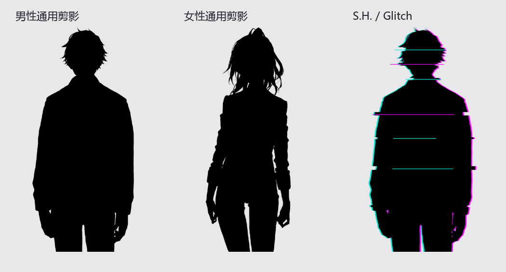

# NPC 图像与玩家关系修订完成记录

后续状态：用户已通过新图，翟明珠已正式采用并同步，S.H. 已应用 Glitch 关系图；93 名 NPC 默认立绘已设为 3/4 身图。见 [新图采用与默认立绘完成记录](../approved-20260902/完成记录.md)。下文保留本阶段历史状态。

2026-09-02，个人服务器 `taiyi` 世界，使用 `AssistantAgent`。

## 线上已完成

- 核对全部 93 名正式 NPC：正式立绘哈希与已导入资产一致；沈漫、沈仲秋、朱瑶光的 Actor Avatar 与原型 Token 已是最新版本。
- 修复 4 名玩家 Relationship 中残留的沈漫、朱瑶光旧图，共 8 条关系。使用模块同步接口，两个同步组的图片及版本号随之更新，关系事件、备注、Rank 均保留。
- 白念秋只替换李好 Relationship 中的 `portrait` 为独立黑白图；Avatar、原型 Token、场景 Token、Relationship 列表小图均保持原值。派生图 RGB 三通道一致，Alpha 与彩色原图逐像素一致。
- 6 名玩家两两建立双向 Rank 1 关系：15 对、30 条，每条进度 0，无虚构事件、无重复。李好个人关系容量由 10 提至 12，其余个人容量保持原值。
- 上传通用男、女剪影与 S.H. Glitch 剪影：每张提供完整 WebP 与 512×512 头像版，6 个文件 SHA-256 与服务器一致，位于 `worlds/taiyi/assets/npc/utility/`。这些是可选素材，尚未自动替换现有 S.H. 或其他 NPC 的角色图。

## 新图

男女剪影以 NAI 原图为底稿，保留轮廓及 Alpha，将内部统一为纯黑。S.H. 使用合格的 NAI 男剪影，派生局部 RGB 错位和横向断层。两次直接 NAI Glitch 生成因背景不透明均未采用；当前派生图有真实透明背景。Glitch 只作为匿名通讯表现，不添加人物本貌或能力设定。

翟明珠已更新人物事实：粉发、巨乳；29 岁及短波波头仍为制图补设。NAI V5 Curated，种子 `1408779885`，832×1216，23 steps，Euler Ancestral / Karras；固定画风与完整原负面词保留，袖上伪文字修正版追加已核验的 `clothes writing`。请求、结果、原图、SHA-256 和 QA 保存在 `../../立绘生产/runs/20260902-ls-npc-006-pink-v4/`。

依照 `../../立绘生产/README.md` 的正式采用规则，这张图为 QA 通过候选，等待主持人选用后才改 `approvedAsset` 和 FVTT 图像。先前误启动的 imagegen 图未采用、未进入项目资产。

## 核验与留档

- `server-before.json` / `server-after.json`：修订前后完整快照。
- `runtime-preview.json` / `runtime-result.json`：预览与真实执行结果。3 次直接图片修改经模块同步影响 9 条关系。
- `verification.json`：118 个 Actor，30 条新增玩家关系，9 条关系图变化；数值、物品、效果、归属、旧关系事件及其他字段无意外变化，所有场景 Token 未变，`failures: []`。
- 模块内部 `.Stylish Relationship Sync Registry` 日志仅两个同步组的图片字段及递增版本号改变；其他日志内容不变。
- `white-relationship-ui.png`：实际界面核对，白念秋大图为黑白、列表头像保持彩色，李好显示 12 条关系及总 Rank 5。30 条玩家关系逐条以实时数据快照验证；后续单独 Rank 1 界面截图因浏览器连接超时未保存。
- `utility-upload-report.json`：6 个剪影派生文件上传哈希核验。
- `presentation-overrides.json`（上级目录）：固定白念秋 Relationship 专用图；导入生成器与运行时已读取这一差异，避免后续导入恢复成彩色。
- 执行 `node scripts/fvtt/audit_npc_refresh.cjs`：通过。
- 执行 `node assets/npc/production/tools/validate-control.mjs`：93 个唯一人物，A67/B20/C6，引用哈希通过。

未触及公开站点内容；未提交 Git，也未修改已有无关工作区变更。
